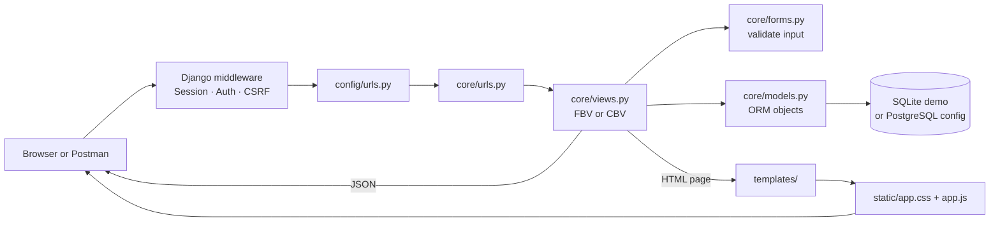
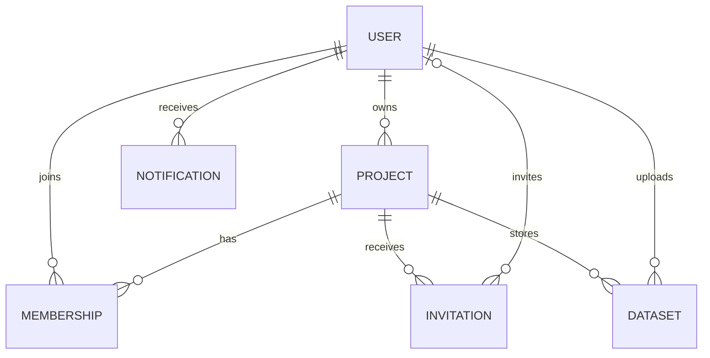
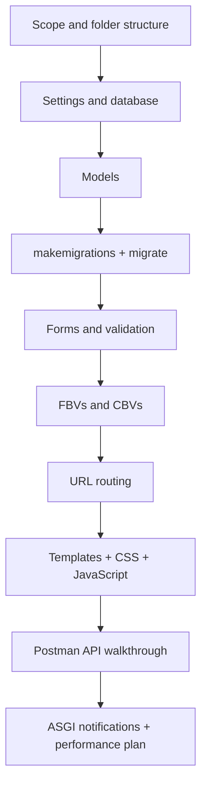

# InsightFlow Django: how the project is built, step by step

This guide follows the **styled Django copy** as if we were building it from an empty folder. It explains why each part is added, what the important code does, and how that step connects to the next one. The folder-by-folder line reference later in the file is a deeper lookup guide. Line numbers there refer to the current source and can shift after edits.

This is a separate copy; the first Django version and the original Vue/FastAPI project are kept separately. The guide presents the logical development order. In practice, the styled version was made by copying the existing Django implementation into its own folder, then updating its templates, CSS, JavaScript, page context, and settings; do not claim that every backend file was newly written from nothing.

## Build the project in this order

## Short terms and abbreviations

- **API — Application Programming Interface:** a set of routes that lets another program, such as Postman or the browser, request or change data. This app exposes routes such as `/api/projects/`.
- **ASGI — Asynchronous Server Gateway Interface:** a Python server interface that can handle HTTP and long-lived connections such as WebSockets. `config/asgi.py` uses it for notifications.
- **Auth — Authentication and authorization:** authentication checks who signed in; authorization checks what that signed-in person may do. Django sessions handle identity, while project owner/membership checks control project access.
- **CBV — Class-Based View:** a request handler written as a class with methods such as `get()` and `post()`. `ProjectListCreateView` is the project API CBV.
- **CSRF — Cross-Site Request Forgery:** a web attack where another site tries to make a browser submit an unwanted request using its existing login. Django’s CSRF token and middleware reject unsafe requests without the correct token. In Postman, fetch `/api/csrf/` and send its token in `X-CSRFToken` for POST requests.
- **CRUD — Create, Read, Update, Delete:** the common data operations. In this project, project creation is implemented; project listing/detail are reads. Full update/delete project screens are not implemented in this Django copy.
- **CSS — Cascading Style Sheets:** rules for the visual design, in `static/app.css`.
- **FBV — Function-Based View:** a request handler written as a Python function, such as `signup_api()` or `upload_dataset()` in `core/views.py`.
- **HTML — HyperText Markup Language:** the page structure in `templates/`.
- **HTTP — HyperText Transfer Protocol:** the request/response protocol used by the browser and Postman. GET reads; POST submits/creates; status codes communicate the result.
- **JSON — JavaScript Object Notation:** a text format used for API request and response bodies, for example `{"name":"Sales analysis"}`.
- **ModelForm:** a Django form connected to a model. It validates submitted fields and can save a model instance; examples are `ProjectForm` and `DatasetForm`.
- **ORM — Object-Relational Mapper:** Django’s layer for querying and saving database rows through Python model objects instead of writing SQL for each operation. Example: `Project.objects.filter(...)`.
- **PostgreSQL / SQLite:** database systems. PostgreSQL is configured as the intended shared database; this local demo currently uses SQLite, a file-based database.
- **SQL — Structured Query Language:** the language relational databases use to select, insert, update, and delete rows. Django’s ORM generates SQL from model queries.
- **UUID — Universally Unique Identifier:** a large identifier designed to be unique, used as a project and invitation ID instead of a simple sequential number.
- **WSGI — Web Server Gateway Interface:** the traditional Python interface for HTTP-only Django serving, exposed in `config/wsgi.py`.
- **WebSocket:** a persistent two-way connection between browser and server. The project prepares `/ws/notifications/` for invitation notifications; the current page does not yet connect to it.
- **X-CSRFToken:** the HTTP header Postman uses to send Django’s CSRF token with POST requests.
- **JavaScript:** browser-side code in `static/app.js` for theme switching, project search, chat bubbles, CSV preview, and upload.

### Step 1 — Decide what this version will do

Start with a small web app scope: users can sign up/sign in, create private projects, see their projects, attach a CSV, and view a local preview. Also create API routes so Postman can exercise project GET and POST requests. The page should look like InsightFlow’s dark teal, project-sidebar/chat-workspace interface.

This step matters because it sets the first data objects and routes. The current project does **not** implement the AI assistant, data cleaning, EDA, or model training. Questions stay in the browser for the session; the uploaded CSV is stored against the selected project.

### Step 2 — Make the Django project runnable

Create `manage.py` as the command entry point, `config/` for project-level configuration, `core/` for InsightFlow features, `templates/` for HTML, and `static/` for CSS/JavaScript. Put Python package markers (`__init__.py`) in `config/` and `core/` so Django can import them.

Add dependencies in `requirements.txt`: Django is the framework, Psycopg is the PostgreSQL driver, Channels/Daphne handle WebSockets, Pillow supports images, and Locust supports load testing. Django starts through `manage.py`; the actual behavior lives in `core/`.

### Step 3 — Configure Django before making database tables

Set up `config/settings.py` first. Register built-in apps and `core`, configure middleware, templates, time zone, static/media files, authentication, and database selection. The important ordering choice is `AUTH_USER_MODEL = "core.User"`: we decide on email-based accounts before generating the first migration, so the database is created with our custom user from the beginning.

The current `.env` uses SQLite to make the local demo easy to run. The alternate settings parse `DATABASE_URL` and select PostgreSQL when `USE_SQLITE=false`. The rest of the app uses Django’s ORM, so it refers to Python model objects instead of handwritten SQL tied to one database.

### Step 4 — Design the data model

Create `core/models.py` before writing the main views. These models are the database blueprint:

1. `User` extends Django’s user model, uses unique email for login, and adds platform role and avatar.
2. `Project` has a name, UUID, owner, and creation time.
3. `Membership` joins a user to a project and stores that person’s project role.
4. `Invitation` records invite email, role, status, project, and inviter.
5. `Notification` stores a message for a user.
6. `Dataset` stores CSV metadata and a file path associated with project and uploader.

The relations define visibility and deletion. A project belongs to an owner; membership connects collaborators; invitations/datasets belong to a project. The platform role on `User` is different from the project role on `Membership`.

### Step 5 — Turn the models into database tables

Run `python manage.py makemigrations core`. Django compares the models with migration history and creates `core/migrations/0001_initial.py`, a list of database operations. Then run `python manage.py migrate`; Django applies that migration along with built-in user/session/admin migrations.

This separation is useful: models describe the desired schema, migrations version changes to it, and the database stores the actual rows/files. After later model edits, run `makemigrations` again, inspect the new migration, then run `migrate`.

### Step 6 — Define and validate incoming form data

Build `core/forms.py` next. `SignUpForm` accepts email, name, password, and confirmation; it normalizes email, checks confirmation, and calls `set_password()` so the stored password is hashed. `ProjectForm` trims and validates project names. `AvatarForm` binds the `ImageField`. `DatasetForm` rejects files with a non-CSV extension or larger than 10 MB.

The views below instantiate a form and call `is_valid()` before saving. That gives the HTML page and API a shared validation layer. Caveat: configured Django password validators are not all called by the custom signup form yet; the current form’s explicit rule is minimum length plus matching confirmation.

### Step 7 — Write the request handlers: FBVs and CBVs

Add behavior in `core/views.py`:

- Use **FBVs** for focused actions: health, CSRF token, signup/login/logout, current account, avatar/CSV upload, invitations, and HTML pages.
- Use **CBVs** for project resources: `ProjectListCreateView.get()` lists private projects and `.post()` creates one; `ProjectDetailView.get()` retrieves one visible project.

An FBV is a regular function that receives `request`; a CBV groups HTTP methods as class methods. Decorators like `@require_GET` and `@require_POST` restrict the method. `@login_required` checks identity. The project handlers also check project membership, because signing in alone must not grant access to somebody else’s project.

For project POST, the view parses JSON, validates `ProjectForm`, assigns the current user as owner, and wraps project plus membership saves in `transaction.atomic()`. If either database write fails, the transaction rolls both back. It returns HTTP 201 on success.

### Step 8 — Connect URLs to those handlers

Create `config/urls.py` for top-level routing: `/admin/` goes to Django admin and the rest are delegated to `core/urls.py`. The app URL table maps page URLs and API URLs to the views. This is how `/api/projects/` reaches the project CBV and `/login/` reaches the login page.

The URL is the path; the HTTP method selects behavior where a view supports more than one method. The same `/api/projects/` path can therefore mean GET (retrieve list) or POST (create project).

### Step 9 — Add login, sessions, and access checks

Use Django’s auth functions in `core/views.py`: `authenticate()` checks credentials, `login()` places identity into a session, and `logout()` clears the session. `SessionMiddleware` loads the session cookie and `AuthenticationMiddleware` exposes the user as `request.user` on later requests. `login_required` protects private views. CSRF middleware plus `` protect POST requests from forged browser submissions.

Platform role (`User.role`) and project role (`Membership.role`) serve different scopes. A user can have a platform role while being Owner, Moderator, Data Scientist, or Reviewer inside one project.

### Step 10 — Build the HTML pages and the InsightFlow look

Create `templates/base.html` first as the shared layout: sidebar, logo, project list, search field, account/sign-out area, header, and theme button. `home.html`, `login.html`, `form.html`, and `account.html` fill its template blocks. `core/context_processors.py` supplies the user’s private/shared projects to the sidebar on all signed-in pages.

Then add `static/app.css` for dark teal colors, responsive sidebar, chat composer, project list, and light-theme overrides. Add `static/app.js` for local theme persistence, project search, prompt bubbles, CSV preview, and the upload request. The template’s class names connect HTML to CSS/JavaScript. Django renders the first page; JavaScript handles small browser interactions.

CSV behavior has two parts: JavaScript reads a small sample locally to draw a preview, then sends the file as `multipart/form-data` to Django. Django revalidates and saves it in media storage and creates a `Dataset` database row. The prompt bubbles are only local: no AI service or chat-history endpoint is connected.

### Step 11 — Add profile image handling

`User.avatar` is a Django `ImageField`; `AvatarForm` validates it; `account_page()` and `upload_avatar()` accept multipart uploads; settings choose `MEDIA_ROOT` and `MEDIA_URL`; the base template displays the saved photo or an email initial. Pillow is needed for image validation. In production, uploaded media should use secured object storage rather than Django’s development media serving.

### Step 12 — Add invitations and WebSocket notification plumbing

First, invitation FBVs create/list invitations and allow an invited account to accept or decline. Accepting creates/updates `Membership`. When the recipient already has an account, the view also writes a `Notification` row.

For real-time delivery, `config/asgi.py` routes WebSocket traffic; `core/routing.py` maps `/ws/notifications/`; `core/consumers.py` authenticates the connection and joins a per-user channel group. The invitation view publishes an event to the group. Daphne serves the ASGI app; an in-memory channel layer works only for a single local process, while multi-worker hosting needs Redis.

This plumbing is not a completed browser feature yet: the page does not open a socket or display notification events, and the HTTP development server is not an end-to-end WebSocket demonstration. No real invitation email sender is connected either.

### Step 13 — Prepare and run a performance workload

`locustfile.py` defines simulated users that request `/api/health/` and `/api/csrf/`, with random pauses. Start the server, then run Locust and choose user count/spawn rate. A local 20-user, 30-second run is recorded in `performance/PERFORMANCE_TEST_REPORT.md`, with the raw CSV output in `performance/`. This workload exercises basic HTTP endpoints, not CSV processing or ML.

### Step 14 — Verify the API with Postman

Import `postman/InsightFlow-Django.postman_collection.json` and run requests in order. GET `/api/health/` confirms the server responds. GET `/api/csrf/` prepares a token. POST `/api/auth/signup/` creates an account and starter project; POST `/api/auth/login/` creates the session cookie. Fetch CSRF again after login, then GET `/api/projects/` to list the user’s projects and POST `/api/projects/` with `{"name":"CSV profiling demo"}` to create one. The collection scripts retain CSRF/project values and Postman’s cookie jar retains the session. Project GET and POST were verified on the local demo.

### Step 15 — Run the project for a demonstration

In PowerShell, from this folder:

```powershell
py -m venv .venv
.\.venv\Scripts\Activate.ps1
python -m pip install -r requirements.txt
python manage.py migrate
python manage.py runserver 127.0.0.1:8021
```

Open `http://127.0.0.1:8021/`, create an account, select/create a project, attach a CSV, show the preview and upload result, then use Postman to show GET and POST. For PostgreSQL, set `USE_SQLITE=false`, configure a real `DATABASE_URL`, and migrate against that database. For WebSocket testing, install dependencies and run `daphne -p 8021 config.asgi:application`.

### What to say to the professor

> “We built the Django version in layers. First we chose the account/project/dataset records and made migrations. Then we added ModelForms to validate input, function-based views for focused actions and class-based views for project GET/POST, and mapped them with URL configuration. Django sessions protect private pages; templates render the workspace while CSS and JavaScript provide the InsightFlow styling and CSV preview. Postman verifies the API. PostgreSQL, WebSocket delivery, image upload, and load testing each have a code path, but we should clearly state which are configured and which have been demonstrated.”

## Folder-by-folder line-level reference

The following sections keep the deeper source reference organized by folder. Read the build steps above for the order in which those parts fit together.

## Start with the project map

### Visual: the Django request path



Follow one arrow at a time: a request arrives, middleware prepares the signed-in user and security checks, URL patterns choose a view, the view validates/queries/saves, then Django returns a rendered page or JSON. Templates connect to CSS/JavaScript by including static assets and matching class names.

### Visual: the main data relationships



`MEMBERSHIP` is the join table between users and projects; its `role` belongs to that project. The owner foreign key is separate. Invitations and datasets belong to one project, while notifications belong to a user.

### Visual: the build order at a glance



The detailed steps above explain each box; the folder reference below helps locate the corresponding code.

```text
manage.py
  └─ config/settings.py selects installed apps, middleware, database, templates
     ├─ config/urls.py includes core/urls.py
     │  └─ core/views.py handles requests
     │     ├─ core/forms.py validates submitted data
     │     ├─ core/models.py describes the database rows
     │     ├─ core/serializers.py shapes API responses
     │     └─ templates/ render pages, static/ adds browser behavior and style
     └─ config/asgi.py routes HTTP and WebSockets
        └─ core/routing.py → core/consumers.py for notifications
```

The usual request path is **URL → view → form/model → database → template or JSON response**. Django’s ORM translates operations on model classes into SQL. The browser does not directly query PostgreSQL.

## 1. Root folder

### `manage.py` — line by line

- **Line 1**: marks the script as executable on systems that honor the Python shebang.
- **Lines 2–3**: import environment and command-line argument helpers.
- **Line 5**: only run the management logic when this file is executed directly, not when imported.
- **Line 6**: tell Django which settings module to load.
- **Line 7**: import Django’s command runner.
- **Line 8**: pass it the command and arguments, for example `migrate` or `runserver`.

### `.env` and `.env.example`

- **`.env`** holds this local copy’s settings. In this folder it selects SQLite and uses a demo-only secret. It is ignored by Git; never publish real secrets.
- **`.env.example`** shows the keys another developer should configure. It is a template, not an active secret store.
- **Connection to Django**: `config/settings.py` reads `.env` at startup. `USE_SQLITE=true` selects `local.sqlite3`; `USE_SQLITE=false` selects PostgreSQL using `DATABASE_URL`.

### `.gitignore`

Lists generated or sensitive things Git should omit: `.env`, Python bytecode/cache directories, the local SQLite database, uploaded media, collected static output, and virtual environments. These are machine-specific or may contain private data. The published snapshot has an empty .gitignore and uses an explicit file selection when staging.

### `requirements.txt`

One dependency per line:

1. `Django` is the web framework and ORM.
2. `channels[daphne]` adds WebSocket support and an ASGI server.
3. `psycopg[binary]` is Django’s PostgreSQL adapter.
4. `Pillow` enables image validation/storage for `ImageField`.
5. `python-dotenv` is listed for environment tooling; this project currently reads its `.env` with a small parser in `settings.py` instead.
6. `locust` runs the performance workload in `locustfile.py`.

`>=` and `<` define allowed version ranges. Pip chooses a compatible version inside that range.

### `README.md`

Short operational reference: installation, server commands, routes, which rubric feature appears in which file, and limitations. This deep-dive guide gives the longer explanation.

### `postman/InsightFlow-Django.postman_collection.json`

This JSON file is a Postman collection, not application logic. Its `info` names the collection; `variable` sets the local URL and values reused between requests; `item` stores requests in run order. The event scripts save the returned CSRF token, generate a unique test email, and remember the created project ID. The request definitions set HTTP methods, URLs, headers, and JSON bodies. Postman’s cookie jar keeps Django’s session cookie after sign-in. After login the collection fetches CSRF again because Django rotates CSRF state when a user logs in.

### `locustfile.py` — lines

- **Line 1** imports Locust’s simulated-user type, task marker, and wait-time helper.
- **Line 3** defines one kind of simulated user.
- **Line 4** documents that these sample requests are anonymous; an authenticated scenario could log in and reuse a cookie.
- **Line 5** gives each simulated user a random pause from half a second to two seconds.
- **Line 6** weights the health task three times more often than the CSRF task.
- **Line 7** sends `GET /api/health/` and gives it a readable label in Locust’s report.
- **Line 8** marks the second task.
- **Line 9** sends `GET /api/csrf/`.

The file is a load-test script. It does not itself contain measured results; those exist only after running Locust.

## 2. `config/` folder: the Django project settings and entry points

### `config/__init__.py`

Empty on purpose. It tells Python that `config` is an importable package.

### `config/settings.py` — line groups

- **Lines 1–3** import operating-system environment access, path handling, and URL parsing for the database URL.
- **Line 5** calculates the project root from the location of this settings file.
- **Lines 6–12** read `.env` if it exists. The loop skips blank/comment lines, splits each setting at the first `=`, trims quotes/whitespace, and uses `setdefault` so a real environment variable takes precedence over the file.
- **Lines 13–15** set the Django secret, debug switch, and allowed host list. A real deployment must use a strong secret, set debug off, and list its hostnames.
- **Lines 17–21** register Django’s built-in admin, auth, content-type, session, message, and static-file apps plus this app (`core`). Django loads their database models and features at startup.
- **Lines 22–27** are middleware, a request/response processing chain. Security headers run first; session middleware loads cookies; common middleware normalizes requests; CSRF guards unsafe browser requests; authentication exposes `request.user`; messages support one-time notices; clickjacking protection sets a frame header. Order matters because later middleware can use earlier middleware’s work.
- **Line 28** says the first URL table is `config/urls.py`.
- **Lines 29–30** configure Django’s template engine, the top-level `templates` directory, app-template discovery, and context processors. Context processors add request/user/messages and the shared project list to each template context.
- **Line 31** identifies the ASGI application used for HTTP and WebSockets.
- **Line 32** identifies the WSGI application used by conventional HTTP servers.
- **Line 33** tells Django that `core.User`, rather than Django’s default user model, is the account model. This must be set before the initial migrations are made.
- **Line 34** selects Django’s standard username/password authentication backend.
- **Lines 36–37** choose SQLite when `USE_SQLITE` is true. The file is `local.sqlite3` in this project folder.
- **Lines 38–42** otherwise parse `DATABASE_URL` and build PostgreSQL settings from database name, username, password, host, and port. `PGSSLMODE` controls TLS preference and `CONN_MAX_AGE` reuses connections briefly. This is configuration only; it does not mean the running local demo is connected to PostgreSQL.
- **Lines 44–49** register Django’s standard password validators. Note: the custom signup form currently enforces an 8-character minimum and password confirmation, but does not explicitly call Django’s `validate_password`, so these four validators are not all being applied by signup yet.
- **Lines 50–53** choose English, the Tunis timezone, internationalization, and timezone-aware database dates.
- **Lines 54–57** configure static files (CSS/JS) and uploaded media locations.
- **Line 58** sets the default generated primary-key type.
- **Lines 59–61** define where unauthenticated browser pages go and where login/logout send users.
- **Lines 62–66** configure session/CSRF cookie protections and unique cookie names so two local InsightFlow apps on different ports do not overwrite each other’s cookies.
- **Line 67** selects Django’s console email backend. Email is printed to the server console, not delivered to a real mailbox.
- **Lines 68–69** record the intended channel-layer mode and use Channels’ in-memory layer for a single development process. Multi-process production normally uses Redis.

### `config/urls.py`

- **Lines 1–4** import Django admin, URL helpers, settings, and the debug media helper.
- **Line 6** maps `/admin/` to admin and includes every application route from `core/urls.py` at the site root.
- **Lines 7–8** expose locally uploaded media only when `DEBUG` is on. A production server should use proper media storage instead.

### `config/wsgi.py`

- **Lines 1–3** import OS support, set the settings module, and ask Django to build its WSGI application.
- **Line 4** exposes that application for WSGI-compatible HTTP hosting. WSGI is for regular request/response HTTP; it does not carry WebSockets.

### `config/asgi.py`

- **Lines 1–2** import OS support and select settings before Django initializes.
- **Lines 3–4** import Channels authentication middleware and protocol/URL routers.
- **Line 5** imports Django’s standard ASGI HTTP application.
- **Line 6** imports the application’s WebSocket route table.
- **Line 8** builds the normal Django HTTP handler.
- **Line 9** dispatches HTTP to Django and WebSocket traffic through authenticated Channels routing. This is why WebSockets need an ASGI server such as Daphne.

## 3. `core/` folder: application behavior and database model

### `core/__init__.py`

Empty package marker so Python can import `core.*` modules.

### `core/apps.py`

- **Line 1** imports Django’s application configuration class.
- **Line 3** defines this app’s configuration.
- **Line 4** sets the default integer primary-key type for models that do not define their own key.
- **Line 5** gives Django the app name used in settings and migrations.

### `core/models.py` — how the tables relate

- **Lines 1–3** import UUID generation, Django’s user base/manager, and model field types.
- **Lines 5–6** declare a custom manager and say Django migrations should serialize it.
- **Lines 7–10** create a user: reject a missing email, normalize it, set a password hash (never store the raw password), save, and return the user.
- **Lines 11–13** create a normal account with staff/superuser flags defaulting false, then delegate shared work to `_create_user`.
- **Lines 14–16** create a superuser with staff/admin flags defaulting true and delegate to the same helper.
- **Lines 18–26** define the custom account. It inherits Django’s standard authentication fields; removes username; adds unique email, platform role, and avatar image; uses email as the login identity; attaches the custom manager; and prints the email as its readable name. `ImageField` stores a file path in the database, while the image bytes live in media storage.
- **Lines 28–33** define a project with UUID identity, name, owner relation, and creation timestamp. `PROTECT` prevents deleting a user who still owns projects. `related_name="owned_projects"` allows reverse lookups from user to projects.
- **Lines 35–41** define project membership and its project-specific roles. Each row links one user to one project; the unique pair prevents duplicate membership rows. These roles are separate from the platform-level role on `User`.
- **Lines 43–51** define invitations with UUID, project, recipient email, requested project role, optional inviter, state, and timestamp. Deleting a project deletes its invites; deleting its inviter leaves the invite but nulls the inviter reference.
- **Lines 53–57** define in-app notification text, owning user, timestamp, and read state.
- **Lines 59–64** define uploaded dataset metadata and a file path. Each dataset belongs to a project and records who uploaded it; deleting a project deletes its dataset row, and deleting the uploader is prevented while their record remains.

**Relationship picture:** one user can own many projects; project membership joins users and projects many-to-many with a role per join; a project has many invitations and datasets; a user has many notifications.

### `core/forms.py` — validation before save

- **Lines 1–4** import forms, obtain the configured custom user model, import project/dataset models, and store the user model in a local name.
- **Lines 6–11** define `SignUpForm` as a `ModelForm`. Password fields are extra form-only fields; the `Meta` class says which `User` model fields are editable.
- **Line 12** trims and lowercases the email after field validation.
- **Lines 13–16** run whole-form validation, compare password and confirmation, attach an error to the confirmation field when they differ, and return the cleaned values.
- **Lines 17–20** override saving to avoid a premature database write, hash the password using Django’s `set_password`, then optionally save.
- **Lines 22–27** define the project-name ModelForm, trim the name, reject whitespace-only content, and return the cleaned value.
- **Lines 29–30** define the avatar ModelForm with only the avatar field.
- **Lines 32–38** define the dataset ModelForm; its cleaner checks `.csv` extension and a 10 MB maximum before the file can be saved.

### `core/views.py` — request handlers, line groups

- **Lines 1–14** import JSON parsing, Django auth, CSRF helper, database transaction and `Q` query objects, response/redirect/template helpers, generic CBV and HTTP-method decorators, local forms/models, and the project-to-JSON helper.
- **Line 16** fetches the configured user class so code does not hard-code Django’s default user model.
- **Lines 18–20** parse a JSON request body; malformed JSON returns `None` rather than crashing.
- **Lines 22–23** restrict the health endpoint to GET and return a small JSON status.
- **Lines 25–26** restrict the CSRF endpoint to GET and return a token for browser/Postman unsafe requests.
- **Lines 28–36** implement JSON signup: require POST; decode JSON; return 400 on malformed or invalid data; validate with `SignUpForm`; save a hashed-password user; create a private starter project; and return identifiers with HTTP 201.
- **Lines 38–45** implement JSON login: parse credentials, authenticate with Django, return 401 if invalid, create a session cookie on success, then return account details.
- **Lines 47–49** implement POST logout by clearing Django’s session and returning confirmation JSON.
- **Line 51** applies `login_required` to the class’s `dispatch` method, so every request method requires a signed-in account.
- **Lines 52–56** define the CBV for project listing. `get()` queries only owned or joined projects, avoids duplicate rows with `distinct()`, serializes them, and returns JSON.
- **Lines 57–65** implement POST on that same CBV: parse and validate the name; create a project but delay saving until owner is assigned; use `transaction.atomic()` so project and owner membership are all-or-nothing; return the serialized project with 201.
- **Lines 67–71** define a protected project-detail CBV. Its `get()` only finds a project visible to the user; `get_object_or_404` returns 404 if absent/inaccessible; then it returns JSON.
- **Lines 73–75** use stacked GET and authentication decorators for `/api/me/`; it returns the logged-in user's account fields.
- **Lines 77–82** handle avatar POST: bind text and uploaded file to `AvatarForm`, return form errors if invalid, save, and return the media URL.
- **Lines 84–92** handle CSV POST: require login and POST; find the project; check the caller is owner or member; validate uploaded multipart form; assign project/uploader/name; save the file and metadata; return JSON with 201.
- **Lines 94–100** list pending project invitations. The function checks the caller is signed in and is owner/moderator, filters to pending rows, and returns JSON.
- **Lines 102–122** create an invitation: parse JSON; find project; enforce owner/moderator access; normalize and validate email/role; create/update a pending invitation; if the email belongs to an existing account, store a notification and publish it to that user's Channels group; unknown users can still receive an in-app invitation after registering; return the invitation with 201. This endpoint does not send real email.
- **Lines 124–128** list pending invitations addressed to the current user's email and include project summary fields.
- **Lines 130–139** accept or decline an invitation. It checks the action, only fetches an invite addressed to this user and still pending, updates status atomically, and creates/updates membership when accepted.
- **Lines 141–146** render the main workspace. It queries only owned/joined projects, chooses the query-string project or first available one, computes the displayed role, and sends context to `home.html`.
- **Lines 148–154** render account settings and save a valid uploaded avatar on POST; GET displays the current avatar form.
- **Lines 156–162** implement browser signup with the same form, create a starter project, log the user in immediately, and render the shared form template when needed.
- **Lines 164–170** implement browser login. POST authenticates email/password; success creates a session and redirects; failure sends an error string to the login template; GET simply displays the form.
- **Lines 172–177** implement protected browser project creation. It binds a form on POST, assigns current user as owner, saves project and a moderator membership, then redirects home; GET displays the form.

**Decorator order/meaning:** `@require_POST`/`@require_GET` protect HTTP methods; `@login_required` protects identity; they do not replace permission checks for a particular project. The upload/invitation views add those project-level checks themselves.

### `core/urls.py` — URL-to-view links

- **Lines 1–3** import Django’s built-in logout view, `path`, and local views.
- **Lines 5–7** map page URLs to home, signup, login, logout, account, and create-project pages. `name=` provides stable names used by template `` tags.
- **Lines 8–10** map API health, CSRF, signup, login/logout, current-user, and project-list/create routes.
- **Line 11** maps a UUID path segment to the project-detail CBV.
- **Lines 12–13** map invitation list and create routes to FBVs.
- **Lines 14–15** map an account's invitation inbox and accept/decline response routes.
- **Line 16** maps CSV upload and avatar upload routes.
- **Line 17** closes the list. `ProjectListCreateView.as_view()` adapts a class into a Django callable; ordinary functions can be passed directly.

### Smaller application modules

- **`core/serializers.py`, line 1** defines a conversion helper; **line 2** determines whether the caller is owner or retrieves their membership role; **line 3** returns JSON-safe project fields and ISO-formatted timestamp. It connects models to API responses.
- **`core/context_processors.py`, lines 1–2** imports query support and Project; **line 4** starts a template context helper; **line 5** returns no private project data for anonymous users; **line 6** returns the current user's owned/joined projects for the shared sidebar. `settings.py` registers this helper.
- **`core/consumers.py`, line 1** imports Channels’ JSON WebSocket consumer; **line 3** defines the notification consumer; **lines 4–7** check authentication and close anonymous sockets; **line 8** gives each user a private group name; **line 9** subscribes this socket to its group; **lines 10–11** accept and send the connection confirmation; **lines 12–14** unsubscribe on disconnect; **lines 15–16** forward a notification event as JSON.
- **`core/routing.py`, lines 1–2** import path helper and consumer; **line 4** connects `/ws/notifications/` to the consumer. `config/asgi.py` loads this table.
- **`core/admin.py`, lines 1–3** import admin helpers and models; **lines 5–12** customize account list/edit/add views in Django admin; **line 14** registers the remaining models. Admin is a development/admin tool, distinct from normal project pages.
- **`core/__init__.py`** is intentionally empty and marks the package.

### `core/migrations/`

- **`__init__.py`** marks the migration package.
- **`0001_initial.py` line 1** records the generation version/time; **lines 3–8** import model definitions, deletion behavior, UUID/time helpers, configured user model reference, and migration primitives.
- **Lines 11–17** declare the first migration and its dependency on Django's auth migration.
- **Lines 19–46** create the custom user database table, including Django password/permission fields plus unique email, roles and avatar.
- **Lines 47–56** create the notification table and its user foreign key.
- **Lines 57–65** create the project table with UUID, name, timestamp, and protected owner foreign key.
- **Lines 66–77** create the invitation table and its project/inviter references.
- **Lines 78–88** create the dataset table with upload path and project/uploader references.
- **Lines 89–101** create the membership table and its unique `(project,user)` pair.
- **Line 102** closes migration operations.

Migrations are a versioned schema history: `makemigrations` creates instructions after model changes; `migrate` applies them to the chosen database. They are not the user data itself.

## 4. `templates/` folder: server-rendered HTML

Django uses `` for template instructions and `{{ ... }}` for escaped values. A view sends a context dictionary; template variables read from it. `` reuses the shared frame.

- **`base.html` lines 1–2** enable static tags and set document metadata/load shared CSS; **line 3** begins the body; **line 4** switches layout based on authentication; **lines 5–14** build the signed-in shell: sidebar, brand, create/search controls, project list loop, account and signout form; **line 15** creates header and inserts the child page content; **line 16** adds theme button and JS; **line 17** renders a smaller sign-in/sign-up shell for anonymous users; **line 18** closes the document. Its `content`, `topbar`, and `auth_content` blocks let child templates supply page-specific pieces.
- **`home.html` line 1** inherits the base and sets title/header blocks; **line 2** begins workspace; **line 3** displays the selected project and role; **line 4** starts the central workspace; **line 5** shows the welcome heading; **line 6** is the initially empty conversation area JavaScript fills; **line 7** is the hidden CSV preview; **lines 8–9** create prompt/file controls and prompt suggestions; **lines 10–12** close the composer/workspace and provide upload status; **line 13** embeds the CSRF token and upload URL for JavaScript; **line 14** handles the no-project state; **line 15** closes the content block.
- **`login.html`** extends the base, sets a sign-in page title, prints any authentication error, submits email/password via POST with CSRF token, and links to signup.
- **`form.html`** provides two template blocks: signed-in users see the form inside the app frame (used for project creation); anonymous users see signup within the auth frame. It prints the passed title/button and renders the Django form with CSRF protection.
- **`account.html`** displays email/role and submits avatar form with `multipart/form-data`, which is required to upload files.

## 5. `static/` folder: browser-side behavior and presentation

### `static/app.js` — line-by-line map

- **Lines 1–2** open a private wrapper function and reference the document root.
- **Lines 3–6** find theme control, read saved theme if possible, and apply it to the document; `try/catch` keeps storage errors from breaking the app.
- **Lines 7–10** toggle dark/light theme on click and persist the choice.
- **Lines 12–18** locate project search and filter project links as the user types; each project name is compared case-insensitively.
- **Lines 20–29** cache references to the prompt, conversation, greeting, suggestions, file input, preview, and status elements.
- **Lines 31–33** make suggestion buttons copy their prompt into the textarea and focus it.
- **Lines 35–44** intercept prompt submission, ignore blank questions, hide the greeting/suggestions, safely add the user’s text via `textContent`, show an honest “AI not connected” note, clear the textarea, and scroll into view.
- **Line 45** makes Enter submit while Shift+Enter inserts a newline.
- **Lines 47–59** parse a small CSV preview. The loop handles commas, quoted strings and doubled quote escapes; newline ends a row outside quotes; it keeps a header and up to five records; an unclosed quote throws a visible error.
- **Lines 60–63** respond to file selection, clear old status, and reject non-CSV or files over 10 MB.
- **Lines 64–66** read file text, strip a UTF-8 byte-order mark, parse it, and reject empty data.
- **Lines 67–71** rebuild preview table using DOM nodes and `textContent` so CSV contents are displayed as text rather than interpreted as HTML.
- **Lines 72–74** display filename/row count/file size and reveal the preview panel.
- **Lines 75–83** create multipart form data, retrieve CSRF token and upload URL from the HTML form, POST the CSV to Django, display an error or upload success.
- **Line 84** catches parsing/network/server errors and shows the message.
- **Lines 85–86** close the file listener and private wrapper.

Important: typing a chat question currently creates a browser-only bubble. It is not sent to an LLM or saved in Django. CSV selection is previewed in-browser and then uploaded to Django for storage.

### `static/app.css`

This file is compacted into five long lines, so a “line” contains many CSS rules. Read it by selector groups:

- **Line 1** defines dark-theme colors, typography, and overall page colors using CSS custom properties.
- **Line 2** overrides the color variables for light mode. `var(--surface)` and similar values let the same layout switch theme without duplicate rules.
- **Line 3** contains the desktop styling groups: global sizing; two-column app/sidebar layout; logo; search/project links; user/account area; top bar; workspace heading; centered welcome/composer; suggestion chips; chat bubbles; CSV table; empty state; form/settings/auth cards; and floating theme button. Each selector corresponds to classes written in `templates/base.html` or `home.html`.
- **Line 4** is the mobile breakpoint (`max-width:760px`): sidebar becomes a compact top section, projects scroll horizontally, header spacing shrinks, and content/buttons adjust for narrow screens.
- **Line 5** honors the user’s reduced-motion operating-system preference by disabling animations and smooth scrolling.

CSS does not call Django or the database. It controls appearance only. The template’s `class` names connect HTML to the selectors.

## 6. How one feature crosses folders: create project

1. The Postman request sends `POST /api/projects/` (collection file).
2. Django middleware checks CSRF and loads the session (`config/settings.py`).
3. `config/urls.py` includes `core/urls.py`; its `/api/projects/` route selects `ProjectListCreateView`.
4. `login_required` checks `request.user`.
5. `post()` in `core/views.py` parses JSON, creates `ProjectForm` from `core/forms.py`, validates it, and sets the current user as owner.
6. `transaction.atomic()` saves `Project` and `Membership` models (`core/models.py`) together.
7. `project_json()` in `core/serializers.py` shapes the response.
8. `JsonResponse` returns HTTP 201 and the project data to Postman.

## 7. Where the professor’s required Django features work

This maps each requirement to actual files and describes what happens at runtime. A feature can be present in source code but still need an external service or dependency before it can be demonstrated live.

### PostgreSQL

- **Code:** `config/settings.py` lines 36–42; `psycopg[binary]` in `requirements.txt`.
- **Runtime:** when `USE_SQLITE=true`, Django stores records in `local.sqlite3`. When false, it reads the PostgreSQL URL, separates database/user/password/host/port, and uses Psycopg. All app queries still go through Django’s ORM, so models and views do not need different SQL for each database.
- **Current project state:** the local demo uses SQLite. PostgreSQL is configured but has not been connected to a live database.
- **Professor explanation:** “PostgreSQL is our intended database. The Django settings can switch to it with `DATABASE_URL`; I used SQLite as a local fallback so the demo starts without external database credentials.”

### CBV — Class-Based View

- **Code:** `ProjectListCreateView` and `ProjectDetailView` in `core/views.py` lines 51–71; routes in `core/urls.py` lines 10–11.
- **Runtime:** Django matches `/api/projects/` to `ProjectListCreateView.as_view()`. The class routes GET to `get()` and POST to `post()`. Its `dispatch` method is wrapped with `login_required`, so both methods require a signed-in user. GET lists accessible projects. POST validates a `ProjectForm`, saves the owner and membership in one transaction, and returns a 201 JSON response. The detail CBV returns one accessible project.
- **Professor explanation:** “A CBV groups HTTP operations for a resource. Here the project class has separate GET and POST methods, with shared authentication protection.”

### FBV — Function-Based View

- **Code:** functions in `core/views.py`: `health`, `csrf_token`, `signup_api`, `login_api`, `logout_api`, `current_user`, upload/invitation handlers, and HTML page handlers. Their routes are listed in `core/urls.py`.
- **Runtime:** each FBV receives a Django `request` and returns an HTTP response. `@require_GET` and `@require_POST` restrict methods; `@login_required` protects private actions. For example, signup parses JSON, validates `SignUpForm`, creates a user and starter project, then returns JSON.
- **Professor explanation:** “We used FBVs for focused actions such as signup and file upload. The decorators make the method and authentication requirements explicit.”

### ModelForm

- **Code:** `SignUpForm`, `ProjectForm`, `AvatarForm`, `DatasetForm` in `core/forms.py`; views instantiate them; `templates/form.html` and `templates/account.html` render browser forms.
- **Runtime:** a ModelForm maps submitted fields to a model. The view calls `is_valid()` before saving. Signup normalizes email, checks that the two passwords match, and hashes the password using `set_password()`. ProjectForm trims/validates names. AvatarForm binds an image to `User.avatar`. DatasetForm checks a `.csv` filename and a 10 MB limit before `Dataset` is saved.
- **Caveat:** settings list Django password validators, but this custom signup form currently does not call `validate_password()`; its own password rule is a minimum of eight characters plus confirmation.
- **Professor explanation:** “ModelForms give us model-aware validation and a controlled save step for signup, projects, profile images, and CSV files.”

### Auth — Authentication and access control

- **Code:** `User`/`UserManager` in `core/models.py`; `AUTH_USER_MODEL`, backend, middleware, and cookie settings in `config/settings.py`; `authenticate()`, `login()`, `logout()`, and `login_required` in `core/views.py`; sign-out form in `templates/base.html`.
- **Runtime:** signup saves a Django user with a password hash. Login authenticates email/password and creates a session. The browser/Postman stores Django’s session cookie. On later requests, session and authentication middleware turn that cookie into `request.user`. `login_required` checks there is a session, while project views additionally check ownership or membership. CSRF middleware and tokens protect POST requests.
- **Roles:** `User.role` is a platform-wide role; `Membership.role` is a role within one project. Project access should be based on ownership or membership, not just the global role.
- **Professor explanation:** “Django manages the password hash and session cookie. Middleware restores the signed-in user on each request; views then enforce project-specific access.”

### WebSocket / notifications

- **Code:** `config/asgi.py` sends WebSocket traffic to Channels; `core/routing.py` maps `/ws/notifications/`; `core/consumers.py` authenticates the socket and joins a per-user group; `Notification` is in `core/models.py`; invitation creation stores/publishes an event in `core/views.py` lines 102–122; `CHANNEL_LAYERS` is in `config/settings.py`.
- **Runtime design:** an authenticated browser connects with its session cookie. Channels puts its user in `scope["user"]`; anonymous sockets are closed. The connection subscribes to `user_<id>`. When an invitation is created for an existing account, the view saves a notification and sends an event to that user group; the consumer forwards it as JSON immediately.
- **How to serve:** install requirements and run `daphne -p 8021 config.asgi:application`. The in-memory channel layer is for one process. Multi-worker deployment needs Redis. The current page has no WebSocket client/notification display, and the HTTP `runserver` demonstration does not validate the WebSocket end-to-end.
- **Professor explanation:** “The ASGI route authenticates a socket and groups it by user. Invitation creation can publish to that group for real-time delivery; the interface still needs to connect and display the event.”

### ImageField

- **Code:** `User.avatar` in `core/models.py`; `AvatarForm` in `core/forms.py`; `upload_avatar()` and `account_page()` in `core/views.py`; upload form in `templates/account.html`; `MEDIA_ROOT`/`MEDIA_URL` in `config/settings.py`; `Pillow` in requirements.
- **Runtime:** the browser sends a multipart file. Django’s ImageField validates it using Pillow and saves the image under `media/avatars/YYYY/MM/`; the database stores its relative path. The sidebar displays that image if it exists, otherwise it displays the first letter of the user’s email. The image itself is a file, not a database blob.
- **Current state:** the code is present, but image upload has not been exercised in this environment. In production, uploaded media should use managed or object storage rather than Django’s debug-only media route.
- **Professor explanation:** “ImageField validates image uploads and stores their path on the user record while the actual file is stored in media storage.”

### Test de performance — performance test

**Reading the saved evidence.** Open `performance/locust-baseline_stats.csv`. The two endpoint rows correspond to the two tasks in `locustfile.py`. The aggregate row combines their requests. Its 95th percentile of 6 ms means about 95% of measured requests finished within 6 ms. The `_stats_history.csv` file records measurements over time. The `_failures.csv` file records request failures, and `_exceptions.csv` records exceptions raised by simulated users. Use the baseline files for the figures in `performance/PERFORMANCE_TEST_REPORT.md`.

- **Code:** `locustfile.py`; Locust dependency in `requirements.txt`.
- **Runtime:** Locust creates simulated users. Each waits randomly from 0.5–2 seconds; the health endpoint is requested three times as often as the CSRF endpoint. Locust measures request times and failures under concurrent load. This sample tests basic HTTP endpoints, not CSV analysis or model training.
- **Run it:** start the app, then run `locust -f locustfile.py --host http://127.0.0.1:8021`. In Locust’s page, choose user count and spawn rate, run the load, and report request count, failures, and response-time percentiles. Do not claim numbers until the run is complete; avoid load-testing shared/production databases.
- **Observed local result:** 437 requests over the run, zero failed requests, 3.20 ms combined average, 6 ms combined p95, and 17.12 ms maximum. It covers only health/CSRF endpoints on the development server.
- **Professor explanation:** “We ran a small Locust load against the health and CSRF endpoints with 20 simulated users for 30 seconds. It recorded no failed requests and a 6 ms p95 response time locally. This is only a smoke-level baseline; it does not measure database-backed work, CSV processing, or production capacity.”

## 8. Run and explain to the professor

In a working Python environment, open PowerShell in this folder and run:

```powershell
py -m venv .venv
.\.venv\Scripts\Activate.ps1
python -m pip install -r requirements.txt
python manage.py migrate
python manage.py runserver 127.0.0.1:8021
```

Open `http://127.0.0.1:8021/`, create an account, create/select a project, attach a CSV, then show the preview and upload message. For WebSockets run `daphne -p 8021 config.asgi:application` after dependencies are installed; regular Django `runserver` is the HTTP demo. PostgreSQL requires `USE_SQLITE=false`, an actual `DATABASE_URL`, the Psycopg driver, and `migrate` against the configured database.

### A concise spoken explanation

> “Django receives a request and middleware handles shared concerns like sessions, authentication and CSRF. The URL configuration routes it to a view. A view validates incoming data with a form, reads or writes model objects through Django’s ORM, and returns either a template-rendered page or JSON. In our example, GET lists a user’s projects and POST creates a project after checking login and validating its name. The models define the tables and relations, while migrations create those tables in the selected database.”

## 9. Scope notes: what not to overclaim

- The styled interface is inspired by the original Vue app, but it is Django templates + CSS + JavaScript, not Vue.
- The live local copy uses SQLite. PostgreSQL settings are present but were not connected in this demo.
- CSV upload and a small client-side preview exist. Cleaning, EDA, modeling, and real AI answers are not implemented yet.
- Invitation and notification APIs exist, but there is no full team-management page or visible notification UI.
- Channels code exists, but WebSocket delivery requires installing dependencies and starting Daphne. It was not verified by the HTTP development server.
- A Locust script and one local smoke-test report exist. Do not present it as a production benchmark or as a test of CSV/ML/database performance.
- Email is configured to Django’s console backend; there is no email verification or live email sender.
- `AUTH_PASSWORD_VALIDATORS` is configured, but the custom signup form should call `validate_password()` if the team wants all standard password checks enforced.
