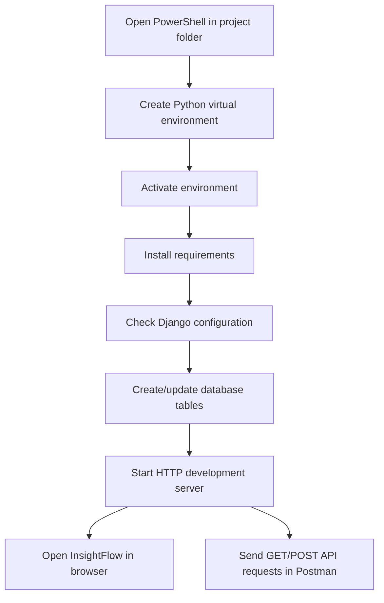
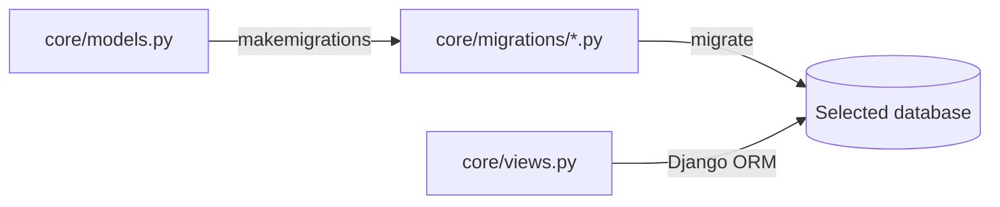
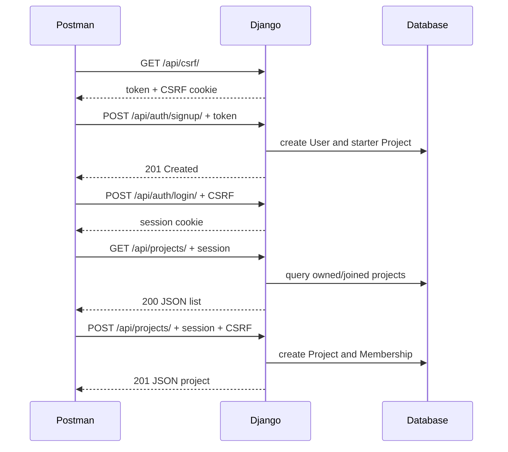

# Run the InsightFlow Django project — command-by-command guide

This guide is for the **styled Django copy** in `InsightFlow-Django-Original-Style`. The first Django copy is separate and remains unchanged. The styled copy runs on port `8021`; the first Django copy used port `8020`.

The current local `.env` selects SQLite so the demo can run without a PostgreSQL service. PostgreSQL, WebSockets, and performance testing need the additional setup described below.

## Visual overview



Each command prepares the next layer: Python environment → packages → settings → database → server → browser/Postman.

## 1. Open the correct folder

```powershell
cd "C:\Users\selmi\OneDrive\Documents\ChatGPT\InsightFlow\InsightFlow-Django-Original-Style"
```

`cd` means **change directory**. It makes this folder the working location, so commands such as `manage.py migrate` use this version’s settings and its own `local.sqlite3`. It avoids accidentally running the first Django copy or the Vue app.

Confirm the location:

```powershell
Get-Location
```

This prints the folder PowerShell is currently using.

## 2. Create and activate a Python environment

```powershell
py -m venv .venv
```

- `py` starts the Python launcher on Windows. If that launcher is unavailable, use `python -m venv .venv` with a working Python installation.
- `-m venv` runs Python’s built-in virtual-environment module.
- `.venv` is the new environment directory inside this project.

The environment isolates this project’s packages from other Python projects.

```powershell
.\.venv\Scripts\Activate.ps1
```

This activates the environment in the current PowerShell window. The prompt usually gains a `(.venv)` prefix. `python` and `pip` commands now refer to the project environment.

If PowerShell blocks script activation, run the interpreter directly instead of activating it:

```powershell
.\.venv\Scripts\python.exe -m pip install -r requirements.txt
.\.venv\Scripts\python.exe manage.py migrate
.\.venv\Scripts\python.exe manage.py runserver 127.0.0.1:8021
```

## 3. Install the project packages

```powershell
python -m pip install -r requirements.txt
```

- `python -m pip` runs pip through the selected Python, so packages install into the same environment.
- `install` asks pip to install packages.
- `-r requirements.txt` reads the package list from the project file.

The list includes Django (web framework and ORM), Channels/Daphne (WebSocket/ASGI support), Psycopg (PostgreSQL driver), Pillow (image validation for `ImageField`), and Locust (performance workload). This command installs software dependencies; it does not create database tables or start the app.

Check Python/Django versions if setup fails:

```powershell
python --version
python -m django --version
```

Use a maintained Python installation with working SSL/network support so pip can download packages. In this desktop environment the default Python had an SSL issue; the existing local server was launched using a different Python runtime. A normal project setup should use one healthy Python environment consistently.

## 4. Check the Django configuration

```powershell
python manage.py check
```

`manage.py` starts Django’s management command system. `check` inspects settings, installed apps, URLs, models, and common configuration errors. It does not contact a real user or run the app’s performance test.

## 5. Create or update database tables

The project already contains `core/migrations/0001_initial.py`. For a fresh local database, run:

```powershell
python manage.py migrate
```

`migrate` applies existing migrations to the database selected in `.env`. With the current `USE_SQLITE=true`, Django creates/updates `local.sqlite3` and tables for core models plus built-in authentication, sessions, and admin. Run `migrate` after installing the project or after a new migration is added.

Only after changing a model, create a new migration with:

```powershell
python manage.py makemigrations core
```

`makemigrations` compares `core/models.py` with migration history and writes new schema-change instructions under `core/migrations/`. It does **not** apply them. Review the generated migration, then run `python manage.py migrate` to apply it.



### Switch to PostgreSQL

The code supports PostgreSQL, but the current local demo uses SQLite. To use a PostgreSQL database, edit `.env` with `USE_SQLITE=false`, a PostgreSQL `DATABASE_URL`, and (if the provider requires TLS) `PGSSLMODE=require`. Install requirements so Psycopg is available, ensure the database exists/reachable, then run `python manage.py migrate`. Do not point this Django version at a production/shared database for a class demo unless that is intentional.

## 6. Start the HTTP development server

```powershell
python manage.py runserver 127.0.0.1:8021
```

- `runserver` starts Django’s local development HTTP server.
- `127.0.0.1` means only this computer can access it.
- `8021` is the port used by the styled Django copy, keeping it separate from the first Django copy on `8020`.

Open [http://127.0.0.1:8021](http://127.0.0.1:8021) in the browser. Use `/signup/` for a new local account. Press **Ctrl+C** in the server terminal to stop it. If the port is already in use, stop the earlier server or choose another port and update Postman’s `baseUrl`.

The development server is for local development, not production hosting.

## 7. Use the app in the browser

1. Sign up; Django validates the form, hashes the password, creates the user, and creates a starter private project.
2. The home view loads projects owned by or shared with that user.
3. Select a project in the sidebar or create one.
4. Attach a CSV. JavaScript reads a small sample for the preview; then it sends the file to Django, which validates it and saves a dataset record/file.
5. Type a prompt to see the chat-style interaction. The question is currently shown only in the browser; it is not sent to an AI model or saved to Django.

## 8. Demonstrate GET and POST with Postman

Import `postman/InsightFlow-Django.postman_collection.json`. Set `baseUrl` to `http://127.0.0.1:8021` if needed. Run requests in this order:

1. **GET** `/api/health/` — confirms the server responds.
2. **GET** `/api/csrf/` — the collection stores the CSRF token.
3. **POST** `/api/auth/signup/` — creates a generated test account and starter project.
4. **POST** `/api/auth/login/` — signs in and stores the session cookie in Postman.
5. **GET** `/api/csrf/` — refreshes CSRF after login.
6. **GET** `/api/projects/` — reads the signed-in user’s projects.
7. **POST** `/api/projects/` with JSON body `{"name":"CSV profiling demo"}` — creates a project and returns `201 Created`.
8. **GET** `/api/projects/{{projectId}}/` — retrieves the project created in the previous request.
9. **POST** `/api/auth/logout/` — clears the session.

GET reads; POST submits/creates. Django’s CSRF middleware checks the token header and cookie for POST. Postman’s cookie jar must remain enabled so it sends the session cookie after login.



## 9. Optional commands for other requirements

### Create an admin account

```powershell
python manage.py createsuperuser
```

Django asks for email/password and creates an account allowed into `/admin/`. This command creates an administrative account; it does not change a normal project user’s project role.

### Run WebSockets

Stop the HTTP server first, or choose a different port. Then, after installing Channels/Daphne:

```powershell
daphne -p 8021 config.asgi:application
```

This starts the ASGI application in `config/asgi.py`, which handles HTTP and WebSockets. The current UI is not yet connected to the notification socket, so a successful server start is not the same as a complete notification demonstration.

### Run the performance workload

Keep the web server running in one terminal. In a second terminal in the project folder and with requirements installed, run:

```powershell
locust -f locustfile.py --host http://127.0.0.1:8021
```

Locust starts a local control page (normally `http://localhost:8089`). Choose a simulated user count and how fast to start them, then run. It measures endpoint timing and failures. The provided tasks hit health and CSRF endpoints only. A sample 20-user, 30-second run is recorded in `performance/PERFORMANCE_TEST_REPORT.md`, with CSV output alongside it.

## 10. Troubleshooting quick guide

- **`py` not recognized:** try `python` or use the full path to the Python executable.
- **Pip SSL/download error:** select a Python installation with working SSL/network support, then recreate/activate its environment and install requirements there.
- **`No module named ...`:** activate the project environment and rerun `python -m pip install -r requirements.txt`.
- **Database/table error:** confirm `.env` selects the intended database and run `python manage.py migrate`.
- **Port already in use:** stop the previous server with Ctrl+C or choose a free port; also update Postman `baseUrl`.
- **POST gets 403 CSRF:** call `/api/csrf/`, send `X-CSRFToken`, keep cookies enabled, and refresh the CSRF token after login.
- **WebSocket fails while HTTP works:** run Daphne using `config.asgi:application` and confirm Channels dependencies are installed; plain HTTP success alone does not test WebSockets.

## 11. What has and has not been demonstrated

The project has been run on port `8021`, and signup/login plus project GET and POST have been verified. A local Locust run is recorded in `performance/PERFORMANCE_TEST_REPORT.md`; it covers health and CSRF only. Local `.env` uses SQLite. PostgreSQL connection, image upload, and WebSocket delivery need their corresponding service/demo before presenting them as tested. CSV upload is implemented; CSV cleaning, EDA, ML, AI answers, and persistent prompt history are not implemented yet.
